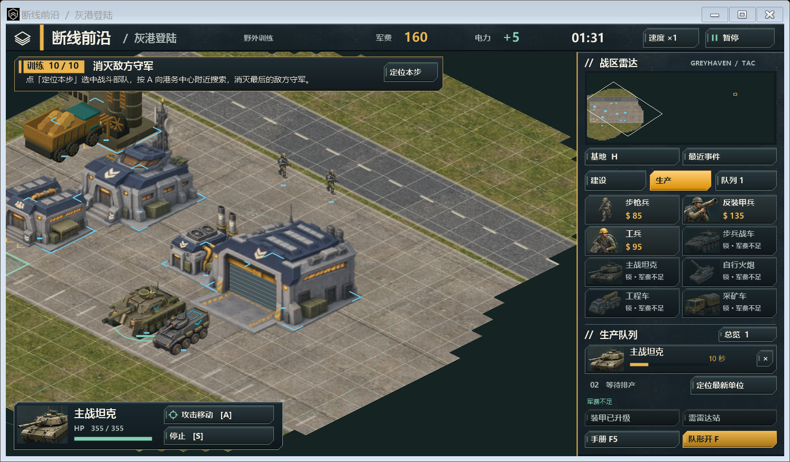

# 断线前沿 · 灰港登陆
现代战争单人即时战略游戏，Windows x64 桌面版 v0.13.0。

**开始游戏**　从 [v0.13.0 发布页](https://github.com/Wenxin666-code/greyhaven-rts/releases/tag/v0.13.0) 下载可执行文件，或在本机项目根目录双击 `断线前沿.exe`。程序在独立窗口中运行，使用 Windows 自带的 .NET Framework 4.x。地图和全部方向图集已嵌入程序，可单独复制 exe，离线游玩。

[查看主界面](docs/主界面.png) · [查看选关页](docs/关卡选择.png)

主菜单的「规则介绍」包含战场规则和 [八种单位的图鉴](docs/单位图鉴.png)。

战场右侧控制台集中显示雷达、建设、生产和队列。当前订单、进度与下一单常驻右侧；点「队列」可切换设施和取消订单。左下角根据选中单位显示生命值与可用指令。暂停后可重开当前关卡或返回选关。

## 镜头与编队
鼠标在战场视口的边缘短暂停留即可连续滚屏，越靠边越快，四角可斜向移动。游戏有焦点时，鼠标越出窗口也能继续滚屏；移回中央或普通侧栏、暂停或切换窗口即停止。也可滚轮缩放、中键拖动、方向键平移或点击小地图定位。按 **G** 显示地面格线和建筑四角。七种基地设施与港务中心都按各自占地校准，四种车辆沿街道的四个正反方向或它们之间的四个方向行驶。同街先走长直段，换街优先在交叉口转向。主战坦克的 64 个车身视图中，八个用于直行，其余用于转动。[查看路口行驶实录](docs/路口行驶.webp)。[查看角度验收图](docs/角度校准.png)。港务中心是中立地标。新手教官的「定位本步」也会把镜头带到任务地点。

混编下达地面命令时，默认由装甲在前、工程与火炮靠后，以队内最慢单位速度推进。按 F 切换随后发出的行军命令是否同步行速，数字编队仍可单独存取。选中已完工的指挥部、兵营或车辆工厂，左键空地设置集结点。受前置条件限制的生产卡会变暗并列出缺项。

## 矿区与军费
玩家须先展开指挥部、建成电站，再花 390 军费放置矿石精炼厂。精炼厂完工且出口畅通后，附带的首辆矿车才从厂门驶出。金色矿石在主地图和小地图上可见。矿车优先前往最近的已发现、可达且有空位的矿点；找不到时会探开未知地形，发现矿石后再驶过去采集。满载 180 后返回己方精炼厂，停靠卸货才入账。每个矿点有 4200 矿量，采完不会再生；最后不足一车的矿也会运回。停止采矿、拦截运输线或摧毁精炼厂都会影响收入；常规军费来自矿车交货。正式战役敌方以工程车和 1150 军费起步，自行展开、建电站和精炼厂。首笔卸货收入到账后，再建兵营、训练步兵、建车辆工厂并付费升级装甲。
选中矿车点矿石指定矿点，点己方精炼厂可提前交货。S 停工或下达普通移动后，可用指令席的「恢复自动采矿」接着工作。扩建精炼厂需 390 军费并附带一辆矿车，车辆工厂可用 195 军费补造。每座厂同时接待一辆矿车。矿点中心和卸货位被占时，矿车改用可达的侧面；行进受阻时重新寻路。[查看实际采集与返厂动画](docs/矿车返厂.webp)。

采矿、返厂及随厂配车的操作参考 [Westwood《红色警戒 2》手册](https://manualzz.com/doc/24314810/westwood-studios-red-alert-2-user-manual)。

## 战场定位与同类选择
- **H** 定位指挥部，尚未展开时定位工程车。**空格** 跳到最近的战场事件，例如遇袭或单位出厂；小地图上方也有「基地」「事件」按钮。
- **Ctrl+F1～F4** 保存本局的镜头位置和缩放，**F1～F4** 召回。**F5** 打开手册，**Esc / Pause** 暂停。
- 选一辆坦克后按 **T** 选中当前画面的己方同型单位，快速再按一次扩展至全图。长按只触发一次，镜头跳转保留原来的部队选择。

## 自动交战
选中一支有武器的单位，地面的虚线圈表示自动锁敌范围。移动部队能在射程外三格内发现已揭示的敌方作战单位或建筑，优先锁定有武器的目标，走到射程内再开火。固定阵地只攻击射程内的目标。行军途中接敌，结束交战后会继续向原目的地前进。
遭到远程火力命中时，部队可沿来火方向寻找射手；如果射手在未揭示区域，只根据最后一次来火位置前进。手动点名集火和指定地面压制优先执行。

## 鼠标指令
- 左键点己方部队选择，再点同一单位取消选中。Shift+左键把单位加入或移出当前选择。按住左键拖动框选。已选部队后，左键点地面移动，左键点可见敌人指定集火目标。准星会标出敌人的名称和编号。
- Ctrl+Shift+左键地面，或按 A 后左键地面，下达攻击移动。Ctrl+左键地面持续压制该坐标，S 停止。右键取消待确认指令，或取消当前选择；取消选择不会撤销已经发出的命令。
- 坦克可以接受任意可达终点，只在八条地格轴向上位移。非轴向目标自动拆成直线与对角线段，遇拐点先停车转车体。

## 从新手训练开始
启动后点「开始游戏」，在选关页选「野外训练」并点「进入训练」。教程共 10 步。第 3～5 步依次要求建成精炼厂、实际采到矿石、获得第一笔卸货收入。随后学习排产、步战协同与歼灭守军；「定位本步」可选中需要的部队、打开对应生产页，或进入建筑放置。训练完成后可直接转入宽松战役。宽松模式有 1700 起始军费，首波主动进攻在 175 秒，标准模式为 1150 军费和 92 秒。

「队列」页可按设施翻页，查看当前生产、预计出列时间与后续订单；点订单右侧「取消」可全额退款。兵营在门前另外保留 3×2 集合格，订单接收时占用其中一格。取消会释放该格。友军无法把集合格指定为停车或集结终点。放置建筑时看绿色矩形地基，金色条是生产设施预留的出口。路面与码头通道不能建造。

## 正式战役
1. 在选关页选「灰港登陆」，选「宽松」或「标准」后点「发起登陆」。初始选中的工程车按 **D** 展开。待指挥部建成，先在「建设」页放置电站，再放置精炼厂。矿车开始运矿后再安排兵营与车辆工厂。
2. 左键点选或拖框选择己方部队，左键地面移动，左键可见敌人集火。**A** 后左键地面可攻击移动。根据视野向敌方单位或建筑下达攻击命令，可在顶部查看剩余敌方目标总数。
3. 从「部队生产」下单。完工兵营和工厂各有四个队列位置，军费在下单时扣除。缺电会拖慢生产并关闭雷达。装甲升级解锁坦克与自行火炮。我方与敌方共用生产、视野、寻路和伤害规则。
4. 步枪兵、反装甲兵、工兵均以单人出场，可分别选中、行军和登车。工兵会维修附近友方车辆和建筑。步战车旁有步兵时按 **D** 装载，再按 **D** 卸下。各兵种按视距揭开未探索区域，地形保持揭示。敌军只有进入本方已经探索的地块才显示。通电雷达把已发现的敌军加入小地图；花费 80 军费后点选一块区域，可一次性揭开局部黑幕。
5. 消灭敌方所有存活单位和建筑即获胜，矿车、工程车和在建建筑都计入。失去指挥部后幸存部队仍可继续作战；己方被全歼则失败。

**快捷键**　Shift 追加选择，Ctrl + 1～5 设置编队，1～5 调出，空格定位事件，F5 战地手册，Esc 取消待下达的指令或暂停。切出游戏自动暂停。暂停菜单可重开本关。

## 项目
- `src` 包含 C# 战役规则和原生窗口绘制。界面、按钮与地图输入均由游戏处理。
- `art/source/v02` 和 `art/source/campaign` 保存母模、导出页和实际游戏图集。`art/review` 是单独保留的美术验收页。
- [初步策划](docs/design/初步策划.md) 是原始目标。[版本记录](CHANGELOG.md) 说明本版实际内容与测试口径。

## 构建及验证
在 Windows x64 使用 PowerShell 7，执行 `./scripts/build.ps1 -Test`。脚本调用系统 .NET Framework 编译器，嵌入素材，生成桌面程序，并运行规则和窗口操作检查。正常构建可省略 `-Test`。重新导出美术素材时使用随项目保留的 Three.js 及其许可证；玩游戏无需安装美术工具。
