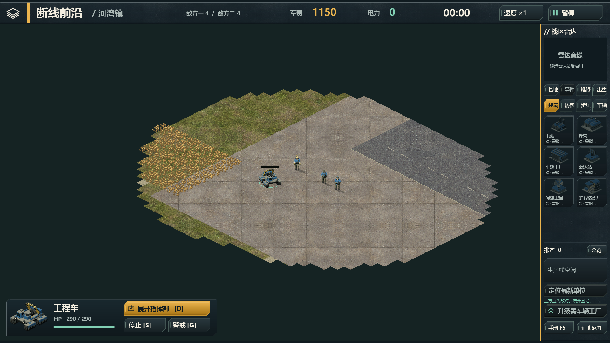

# 断线前沿 · 灰港登陆

现代战争单人即时战略游戏，Windows x64 原生桌面程序。当前版本 **v0.18.0**，累计更新内容见 [版本记录](CHANGELOG.md)。

从 [v0.18.0 发布页](https://github.com/Wenxin666-code/greyhaven-rts/releases/tag/v0.18.0) 下载 `Greyhaven-v0.18.0.exe` 后直接运行，或在本机项目根目录打开 `断线前沿.exe`。地图和正式素材均嵌入程序，可离线游玩；需要 Windows 自带的 .NET Framework 4.x。

## 关卡

- **01 野外训练**：十步教学，学习基地展开、侧栏建造、采矿收入、排产与部队作战。
- **02 河湾镇**：220×150 格三方战场。玩家在西南，两个互相敌对的电脑阵营分别在东北和东南，各自建设、采矿和产兵；消灭两方所有存活单位和建筑后获胜。
- 河湾镇包含河湖、三座桥梁、高地坡道、林带、矿区与 28 栋中立房屋。工兵先占领房屋，步枪兵和反装甲兵再进入驻防；选房按 D 撤离。房屋被摧毁时存活驻军撤出。
- 旧战役入口关闭，旧地图仍保留为内部回归场景。

## 建设与经济

建筑在侧栏生产，完成后选取并放置，落地播放展开动画。建筑与防御独立排产，实际地基显示红绿提示；可在已有建筑附近扩建，平坦道路允许建造，水域、陡坡、占用格等禁止建造。没有统一的门前额外禁建行，但应保持生产出口和卸矿口畅通。

建筑与单位随生产进度扣款，缺钱时等待。生产图标右键暂停，再次右键取消并退回实际已付费用；左键继续。基础工时为价格 × 0.042 秒，电力和同类设施数量影响生产速度。多个同类设施共用队列，可双击设施或用按钮指定主要出口，切换保留生产进度。

基地车再次点击自身或按 D 展开。选中基地点击地面，可收起成车并移动；D 可原地收起。搬迁保留受损比例，建筑订单在没有展开基地时等待。K 进入付费维修模式，L 进入出售模式。

精炼厂价格 390，完工且出口畅通后附带一辆矿车；车辆工厂可用 195 补造。矿车采集连续矿格，满载 180 后返厂卸货才获得军费。矿格逐格耗尽且不再生，教学关每格 240、河湾镇每格 480；矿车会重新寻找附近可达矿格，矿尽后的不足一车也会运回。多车按卸货流程排队，受阻时绕行、等待或转往其他可达精炼厂。

工兵进入建筑占领／修复后消耗；工兵进入步兵战车后，车辆切换为维修模式并停用攻击，可点名维修和卸载工兵。中立房屋仍遵循先占领、后驻防的顺序。

雷达建成且正常供电后启用小地图，不附带扫描能力。另可建设间谍卫星：750 军费、耗电 6，需雷达与车辆工厂；正常供电时揭示全图，失效后恢复本方探索记录。

## 操作

- 默认无边框全屏，Alt+Enter 切换窗口；滚轮缩放、中键拖动、方向键及屏幕边缘滚屏。正式战斗缩放范围 1.05～2.4，默认 1.55，全图预览仅用于选关。
- 左键选择、框选及下达移动／攻击命令，Shift 增减选择，右键取消选择或待确认操作。再次点击已选单位通常保持选择；基地车等可部署单位执行对应部署操作。
- 情境鼠标提示可移动、不可达、攻击、采矿、卸货、部署、维修与出售等状态；点击不可达地块保留原选择和路线。
- Q/W/E/R 切换建筑、防御、步兵和车辆分类；Q/W 可取出对应已就绪建筑。D 展开／收起／卸载，K 维修，L 出售。
- Ctrl+Shift+左键攻击移动；Ctrl+左键强制开火，Alt+左键强制移动；Ctrl+Alt 地点警戒或护卫。S 停止，G 警戒，X 散开，F 镜头跟随。按住 Z 点击路径点，点击首个标记可闭合巡逻。
- Ctrl+1～9 建立编组，1～9 选择编组；T 选择画面内同类，快速再按扩展至全图；P 全选，M/N 切换单位。
- H 定位基地，空格定位事件；Ctrl+F1～F4 保存镜头，F1～F4 召回；F5 手册，Esc 取消操作或暂停。切出游戏自动暂停。

普通移动优先完成路线，坦克可进行机会射击；攻击移动会搜索、接敌并在射程位置停下作战，之后继续路线。警戒迎敌后返回，护卫跟随目标。混编配速允许落后者追赶，持续受阻者不拖停整队；后排攻击者会寻找射击位置。射程与搜索范围辅助显示默认关闭。

## 美术与模型

单位、建筑采用统一材质与光照，以装备和轮廓区分类型；实际战场尺寸与地基占格协调。主菜单「模型预览」可查看单位和建筑、自定义势力颜色，单位支持方向切换，矿车可切换空满载。涂装与本体独立，支持任意 RGB。

战场包含施工、坍塌、开火、命中、受损烟火、维修火花、采矿和行车扬尘，以及士兵与建筑阴影。选择角标和血条采用像素边缘，并与实际模型位置对应。

[单位模型](docs/全单位模型.png) · [建筑总览](docs/建筑重绘-v05.png) · [动画演示](docs/建造开火损毁-v06.mp4) · [第一版及历史素材归档](art/archive/unit-art-history-20261106/README.md)。旧验收动画继续保留，不作为正式运行素材加载。

## 项目与验证

- `src`：C# 游戏规则、原生界面和绘制；`maps`：地图数据；`tests`：规则、交互和性能检查。
- `art/source`：可编辑模型与图集；当前使用 `units-v04`、`tank-prototype`、`buildings-v05`、`animation-v06` 等素材。`art/review` 为验收资料，历史模型保留。
- `docs/design`：设计记录；`docs/research`：机制调研与来源说明。研究材料中的外部项目名称用于来源归属，版本说明描述本项目实际变化。
- 修改前的临时快照保留在本机 `art/archive/*-before-*`，不加入仓库；正式历史美术归档仍同步保存。

在 Windows x64、PowerShell 7 下执行 `./scripts/build.ps1` 构建。完整游戏回归执行 `./scripts/build.ps1 -Test -RiverPreview -MapPreview`；建造操作专项执行 `./scripts/build.ps1 -ConstructionPreview`。导出美术使用项目中的 Three.js 与其许可证，玩游戏不需要安装美术工具。

本版通过建造、经济、工兵、窗口操作、教学、两种自动通关、三方地图、编队与矿车回归；性能结果为测试场景数据，不保证所有机器恒定帧率。
