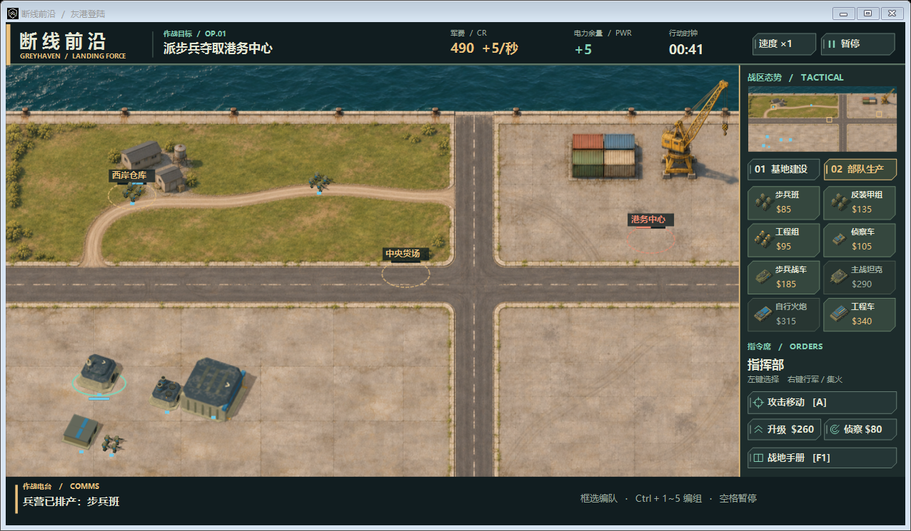

# 断线前沿 · 灰港登陆
现代战争单人即时战略游戏，Windows x64 桌面版 v0.1.0。

**开始游戏**　从 [v0.1.0 发布页](https://github.com/Wenxin666-code/greyhaven-rts/releases/tag/v0.1.0) 下载可执行文件，或在本机项目根目录双击 `断线前沿.exe`。程序在独立窗口中运行，使用 Windows 自带的 .NET Framework 4.x。地图和全部方向图集已嵌入程序，可单独复制 exe，离线游玩。

## 第一局
1. 点击「发起登陆」。初始选中的工程车按 **D** 展开。待指挥部建成，从右侧「基地建设」选电站、兵营，再点击指挥部附近的空地放置。车辆工厂需要已建成的电站。
2. 左键点选或拖框选择己方部队，右键地面移动，右键可见敌人集火。**A** 后左键地面可攻击移动。让步兵进入仓库或货场圆圈，占领后军费收入提升。双方步兵同时在圈内会阻止占领。
3. 从「部队生产」下单。完工兵营和工厂各有四个队列位置，军费在下单时扣除。缺电会拖慢生产并关闭雷达。装甲升级解锁坦克与自行火炮。蓝军与红军共用生产、视野、寻路和伤害规则。
4. 步兵、反装甲组、工程组均可占点。工程组会维修附近友方车辆和建筑。步战车旁有步兵时按 **D** 装载，再按 **D** 卸下。侦察车扩大目视距离，通电雷达可侦测移动的敌车；付费无人机扫描可短时确认全区目标。火炮可借友军视野攻击。
5. 让步兵夺取东侧港务中心，再守住 45 秒。近敌会暂停靠岸计时，易手会重置计时。最后一座指挥部和工程车全部损失时任务失败。

**快捷键**　Shift 追加选择，Ctrl + 1～5 设置编队，1～5 调出，空格暂停，F1 战地手册，Esc 取消待下达的指令或暂停。切出游戏自动暂停。暂停菜单可重开本关。

## 项目
- `src` 包含 C# 战役规则和原生窗口绘制。界面、按钮与地图输入均由游戏处理。
- `art/source/v02` 和 `art/source/campaign` 保存母模、导出页和实际游戏图集。`art/review` 是单独保留的美术验收页。
- [初步策划](docs/design/初步策划.md) 是原始目标。[版本记录](CHANGELOG.md) 说明本版实际内容与测试口径。

## 构建及验证
在 Windows x64 使用 PowerShell 7，执行 `./scripts/build.ps1 -Test`。脚本调用系统 .NET Framework 编译器，嵌入素材，生成桌面程序，并运行规则和窗口操作检查。正常构建可省略 `-Test`。重新导出美术素材时使用随项目保留的 Three.js 及其许可证；玩游戏无需安装美术工具。
