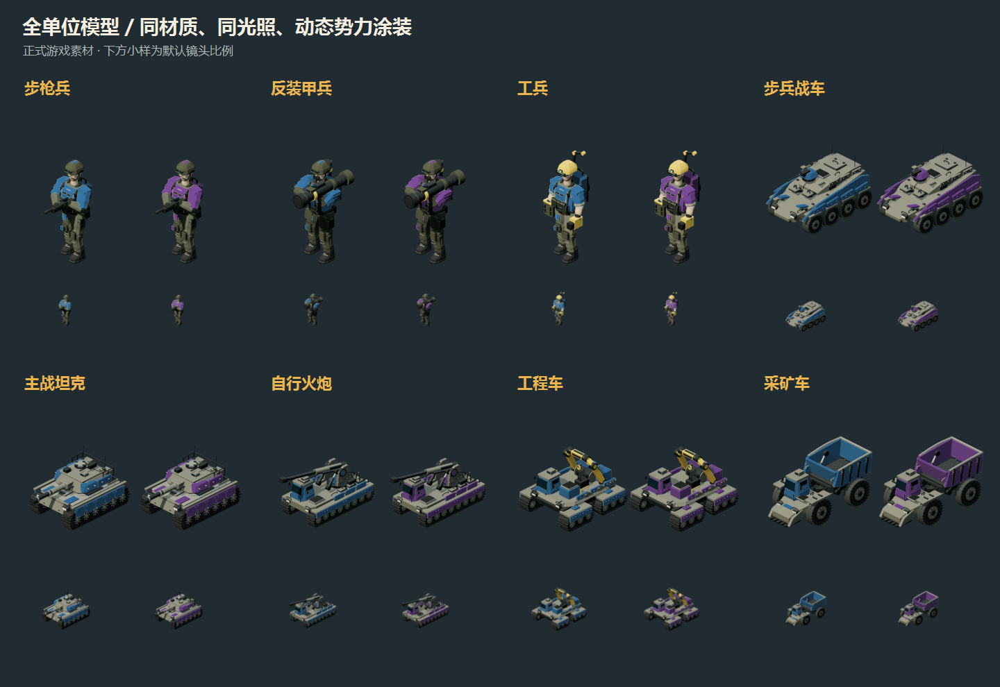

# 历史单位模型 v03 · 2026-11-06

**已停用，保留记录。** 用户认为本批模型过粗、轮廓辨识度不足，已由 [v04 试用模型](../units-v04/README.md) 替换。原模型、场景和图集均保留，当前构建不加载本目录。以下记录描述当时实现，图片链接随当前开发版更新，不代表本批固定截图。历史源码可用 `node scripts/export-unit-models.cjs --revision=03` 单独重建，不会替换当前 v04 图集。

## 查看与识别

根目录打开 `断线前沿.exe`，主菜单选择「模型预览」。可切换八类单位、旋转、切换矿车空/满载、选择八种示例色或任意自定义颜色。点击「应用到己方部队」影响本次运行的所有己方移动单位，重启恢复默认；建筑保留原配色。战役仍是双阵营。

| 单位 | 识别特征 | 方向数 |
| --- | --- | --- |
| 步枪兵 | 头盔、步枪、弹匣 | 8 |
| 反装甲兵 | 肩扛发射筒 | 8 |
| 工兵 | 黄色安全帽、扳手、工具袋 | 8 |
| 步兵战车 | 八轮、短炮、后部载员舱 | 16 |
| 主战坦克 | 宽履带、低炮塔、模块化侧裙 | 64 |
| 自行火炮 | 后置高炮室、超长炮管 | 16 |
| 工程车 | 六轮底盘、折叠起重臂 | 16 |
| 采矿车 | 六轮、敞口矿斗，独立满载模型 | 16 |

## 模型与涂装

- `models.js`：可编辑几何模型，复用坦克样板的材质和几何工具。
- `models/*.json`：可由 Three.js ObjectLoader 加载的模型场景。
- `packed/*-base.png`：中性本体与透明轮廓。
- `packed/*-paint.png`：独立灰度涂装层；胸背、肩部、装甲、驾驶室与矿斗等大面积区域使用可换色材质。
- `packed/*-wreck.png`：车辆残骸；步兵倒地由游戏对相同方向的本体与涂装层同步变换生成。
- `audit.json`：每个视图的不透明像素与边界检查。

运行时将涂装层与势力 RGB 相乘，保留明暗与遮挡；不是替换固定蓝色或红色。玻璃、履带、皮肤、裸露金属和黄色工具不随势力变色。各方向来自同一模型旋转，30° 相机仰角与地图一致。其他单位以 768 像素源图抗锯齿缩至 384 像素单格，坦克沿用 1024 至 512 像素流程，不做低分辨率最近邻放大。

游戏仍使用离线生成的方向图集，无须浏览器或实时 WebGL。保持既有单位大小、碰撞、移动、射程与战斗参数；本次没有新增完整步行动作或开火动作帧，原有动作效果继续使用。`art/review/animation-v01` 仍只归档，不接入。

## 重建与验证

1. 设置 `PLAYWRIGHT_MODULE` 为已安装的 Playwright 包路径，机器安装 Microsoft Edge。
2. 项目根目录运行 `node scripts/export-unit-models.cjs`；可追加 `squad`、`miner-full` 等键名仅导出指定模型。坦克单独使用 `node scripts/export-tank-prototype.cjs`。
3. `./scripts/build.ps1 -Test` 构建并运行完整回归；没有模型修改时不需要重新导出素材。
4. `./scripts/build.ps1 -ModelPreview` 检查预览操作与颜色，更新 `docs/全单位模型.png` 等原生绘制截图。

本轮完整教程、两类战役、编队、矿车、点选与窗口回归通过；所有移动单位方向图的双方透明轮廓一致、中性色隔离、可换色面积、步兵倒地方向及预览单位切换/满载切换通过。坦克继续通过 64 朝向、自定义势力编号/RGB、缓存颜色隔离与真实行驶投影检查。截图下方小样使用默认镜头下的实际显示尺寸。

## 历史素材

第一版和后续旧单位素材共 50 个文件已 [归档并校验](../../archive/unit-art-history-20261106/README.md)，原文件也保留。旧单位图集不再进入当前程序；早期目录中仍使用的建筑、地图及共享依赖不属于停用范围。
