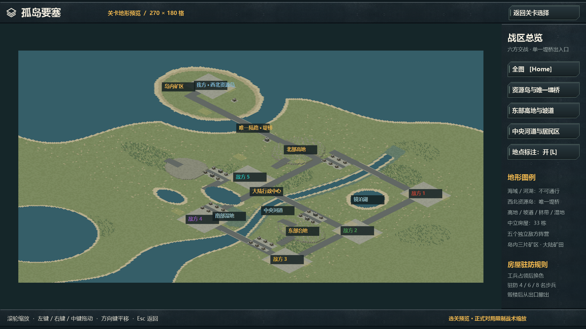

# 孤岛要塞与智能敌军

> 当前地图为 270×180 格，选关缩略图、全图预览和实战共用这个范围。大陆外缘收紧，岛内三片矿区和唯一堤桥仍是我方开局的地形重点。下方尺寸与出生点表为首版档案。[当前全图](../孤岛要塞-全图.png) · [当前地格数据](../../maps/island-fortress-v03.json)

> 2026-11-08 后续：正式关卡默认 2×；决策、扩产、集结与独立袭扰已继续调整，当前数值和同开局验证见 [对局时间与 AI 节奏](../research/对局时间与AI节奏-20261108.md)。下文保留首版设计说明。

2026-11-07，本地未发布更新。第一教学关和第二关保留；没有提交或上传 GitHub。

## 第三关：孤岛要塞

从「开始游戏 → 03 孤岛要塞」进入。地图为 360×240 格，共 86,400 个地格，面积约为第二关的 2.62 倍。正式游戏仍采用 1.05～2.4 的战术缩放范围，默认 1.55；全图仅用于选关预览。

玩家位于西北资源岛。岛屿四面环水，通过一条宽 6 格、长 36 格的堤桥连接大陆，便于部队和矿车通行。岛内三片矿田合计 194 个矿格，初始矿量 93,120；矿格沿用每格 480 的规则，采完不再生。

大陆包含河流、三处跨河桥、湖泊、湿地、林带、岩石高地、真实坡道和居民区。海水与湖河不能通过，林木和陡崖需要绕行，坡道可通行；没有额外加入地形伤害、射程或湿地速度加成。

全图 40 栋中立建筑初始为灰白色，仍由工兵先占领，步兵再驻防。驻防、撤离、建筑被毁后的疏散规则保持一致。

以下出生格坐标从零开始计数：

| 阵营 | 颜色 | 出生格 | 地区 |
| --- | --- | --- | --- |
| 玩家 | 蓝 | 36,30 | 西北资源岛 |
| 敌方一 | 红 | 320,31 | 大陆东北 |
| 敌方二 | 绿 | 325,115 | 大陆东部 |
| 敌方三 | 金 | 316,209 | 大陆东南 |
| 敌方四 | 紫 | 191,213 | 大陆南部 |
| 敌方五 | 青 | 163,105 | 大陆中西部 |

六方互为敌对，没有预设联盟。每方均以 1150 军费、1 辆工程车、2 名步枪兵、1 名工兵开局，展开后自行采矿、建造和生产。消灭或迫使全部五个敌方投降后获胜。

[资源岛与堤桥](../孤岛要塞-资源岛与堤桥.png) · [选关界面](../孤岛要塞-选关.png) · [正式开局](../孤岛要塞-正式开局.png) · [六方雷达](../孤岛要塞-六方雷达.png) · [地图数据](../../maps/island-fortress-v01.json)

## 第二、三关的 AI 更新

- **持续生产**：移除地形关卡中阵营整体每 14 秒才添加一单的限制，按兵营与车辆工厂实际空闲程度接单，维护少量后续订单。兵营和车辆线可同时工作；资金、价格、工时和供电规则与玩家相同。
- **扩大经济**：随时间和已有矿车逐步增加至 2～4 辆矿车，预留发展资金，扩建第二座精炼厂。经济和军力允许时增建第二座车辆工厂与兵营。精炼厂的附赠矿车也计入预计矿车数量。
- **建设与战备并行**：建筑生产、招兵、回防分别判断，等待雷达或其他建筑时仍可生产已有兵种。选址同时检查地基、自身实际出口和现有设施的出口，避免首辆矿车困在精炼厂内。
- **调整兵种**：根据已知敌军的装甲、步兵比例调整反装甲兵和战车；车辆工厂完工后维持坦克、步兵战车与火炮混编，不再另付全局升级费用。第三阵营略提高火炮比例。
- **组队作战**：前期至少 4 人、后期至少 6 人形成进攻小队，每队最多 10 个单位，使用共同编队前进。新部队在基地集结，后续小队接续出击；存活小队在目标消失或抵达后重新选择任务。
- **应对袭击**：记忆近期攻击方，基地附近出现威胁时抽调部队回防；受威胁矿车暂时撤向基地，危险消退后恢复采矿。设施受损且资金允许时开启正常付费维修。
- **争夺与侦察**：工兵优先寻找安全的中立房屋，步兵驻防保留为有限的防守投入，避免全部前线兵力填进房屋。空闲轻型单位会进行侦察。
- **选择对手**：结合距离、已知目标、近期袭击和当前对手选择进攻方向。五个 AI 会互相交战，玩家不会被固定设为所有 AI 的唯一目标。

AI 对军事单位的判断遵守本阵营探索记录，不读取未探索区域的敌军位置。出生区和地图上中立房屋的位置用于初始导航。AI 没有额外军费、生命、射程或生产速度加成，间谍卫星仍需建设、付费并供电。

AI 会按发展阶段维护目标军队规模，第三关目标最高约 36 个战斗单位，第二关约 42 个；这是机器人决定何时继续采购的策略，未给玩家增加单位总量限制。每座生产设施的 30 单容量保持不变。

## 六方支持与性能

资金、订单支付、迷雾、雷达、间谍卫星、矿石收入、建筑供电动画、进攻记忆和投降状态均支持六方。颜色沿用独立涂装，五个敌方使用不同颜色。投降逐阵营判断，任何一个仍具备抵抗能力的敌方都会阻止提前获胜。

导航保留原有八方向、障碍扫掠与单位碰撞规则。静态地形通行和相邻连接复用缓存，建筑变化只重建相应障碍网格；A* 复用搜索数组与二叉堆。封闭的小目标区域先局部检查，避免无效扫描整片大陆。

各阵营的战略决策错开发生，AI 小队长距离路线也按更新分批安排；玩家指令仍即时处理。第三关鼠标预选使用有上限的只读路径查询缓存，避免每次悬停都计算整片大陆的连通分区；查询不修改单位命令。地形继续使用有 64 MiB 上限的可见区域分块缓存，地图扩大后不生成整幅战场大位图。

## 本地验证

专项命令：`scripts/build.ps1 -AiVerify`；带地图截图和数据导出：`scripts/build.ps1 -IslandPreview`。

本轮验证覆盖：

1. 六个出生点、40 栋房屋入口与地形连通。移除唯一堤桥后，玩家与全部五个敌方均断开。
2. 玩家在正常 1150 军费下展开、付费建电站和精炼厂、取得首笔矿石收入；步兵、坦克和矿车实际穿过堤桥。
3. 六方资金、迷雾、染色、雷达／卫星及独立投降；没有提前胜利或遗漏后面三个阵营。
4. 28,800 个相邻连接与原始扫掠结果逐项一致，涵盖三种单位宽度与建筑变化后的网格失效。
5. 第二关六分钟、第三关七分钟自动推演；所有敌方完成首笔采矿、工厂建设、增派矿车和组队进攻。第三关存活阵营发展出第二座精炼厂及第二座车辆工厂；部分阵营在互战中被消灭。
6. 多工厂并行、原有经济和建设支付、工兵、生产队列、投降、十步教程、两套旧战役、拥堵与矿车、原生窗口、第二关驻防及滚屏检查。

原生日志与最终摘要保存在 `.cache/third-acceptance-final.log`、`.cache/third-regression.log` 和 `.cache/third-validation.json`。局部滚屏与模拟耗时仅代表对应场景和本机采样，不等同于所有局面都能保持固定帧率。

未重新导出旧建筑和单位素材；原有势力色、大小、占格、碰撞、施工、待机、爆炸弹片及旧素材记录保留。
