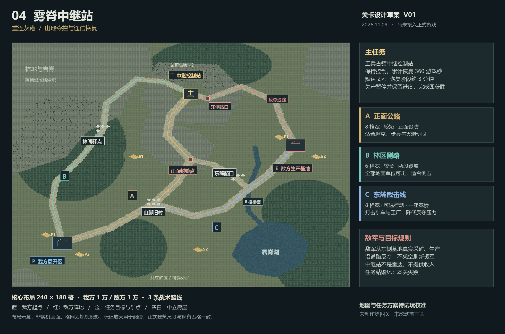
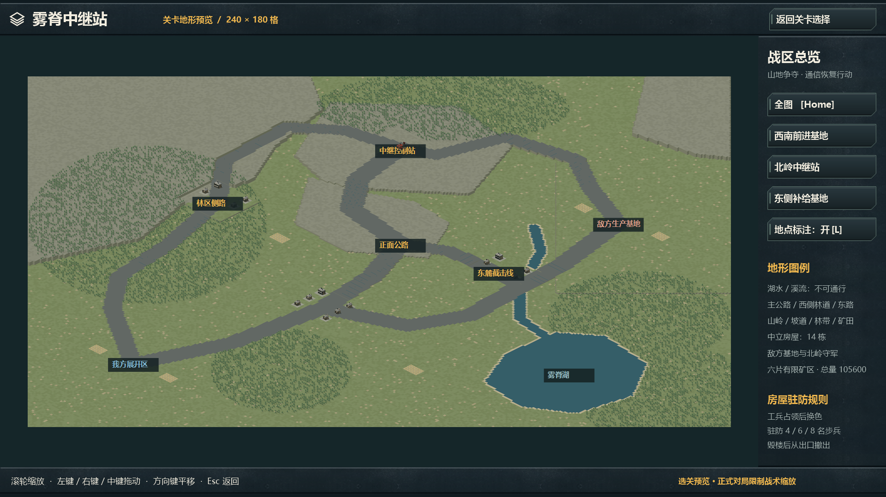

# 第四关 雾脊中继站

2026-11-09 数值统一更新：当前玩家开局军费 5750，单矿格 2400，半程一次性支援 7500；下方首版模拟数字保留作历史记录。共同的规则和最新验证见[战斗数值说明](../research/战斗数值统一-20261109.md)。

《重连灰港》关卡设计与本地实现 v0.2 · 2026-11-09。

本关承接第三关取得资源岛与外围工业带的结果，以**建立前进基地、选择上山路线、工兵夺控、守住通信恢复**为主循环。第四关已接入本地游戏的正式选关。本文保留设计目标，末尾记录实际完成的验证与尚待玩家试玩校准的范围。

地图采用雷达方向的规划投影。区域标记放大用于阅读，不代表实际建筑大小；道路、坡道和入口最终以正式地图的地格、碰撞与寻路结果验收。[结构化设计数据](雾脊中继站-v01/level-plan.json)位于策划目录，不是可加载的正式地图。

## 故事与行动简报

孤岛行动结束后，周砚汇总了矿业盆地各处的调度记录。几份封路命令的时间早于灰港失联，但本地记录不足以确认来源。雾脊中继站保存着原始调度备份，也能够重新接通灰港与内陆的区域通信。

统辖部的通信警戒群仍控制山顶设施，并在东麓建立生产基地。先遣队由西南进入山谷，岛上的保障部队接管后方；玩家需要建立新的前进基地，夺取站区并完成线路恢复。

可直接用于选关页的简报：

> 孤岛的调度记录表明，一部分封路命令早于灰港失联。原始备份保存在雾脊中继站，统辖部警戒群仍控制着那里。你将从西南山脚展开基地，选择道路突破守军，再派工兵接管完整的中继设施。守住恢复过程，让灰港重新听见内陆的声音。

任务目标：**工兵占领中继控制站，保持设施完整，累计完成通信恢复。**

这一关不要求消灭全部敌军。玩家可以正面攻坚、绕行夺站后防守，或先破坏敌方生产与采矿，再从容占领。

## 规模、开局与节奏

| 项目 | 初版方案 |
|---|---|
| 规模参考 | 240×180 格核心尺度；以完整雷达投影域组织实际地形，约为第三关同口径投影面积的一半 |
| 战场轮廓 | 山谷、林脊、东侧台地与湖河；铺满雷达图的四角，陆地不按核心矩形裁切 |
| 势力 | 玩家与统辖部通信警戒群，共两方；敌方基地、前哨和站区属于同一阵营 |
| 玩家起点 | 雷达图约横向 15%、纵向 82%，西南山脚，平坦展开区不少于 30×24 格 |
| 玩家开局 | 5750 军费，工程车 1、步枪兵 2、工兵 1、步兵战车 1；无预建精炼厂或矿车 |
| 敌方总部 | 雷达图约横向 84%、纵向 42%，东麓台地；与我方起点明显分离 |
| 目标站区 | 雷达图约横向 53%、纵向 21%，北部山顶；站区平整场地约 28×22 格 |
| 默认速度 | 沿用正式关卡 2×；试玩时长目标 18～28 分钟，没有开局总倒计时 |
| 完成恢复所需时间 | 累计 360 游戏秒；连续控制且以 2× 游玩时约 3 分钟现实时间 |

尺度中的“核心”仅用于和已有地图比较，不是可玩边界。设计数据给出完整投影域 u=x−y、v=x+y；正式生成地图时，域内地格都必须明确保存地表、通行和高程，不能让布局范围外的角落回落为没有意义的背景。

步兵战车提供第一次上山的机动选择。工兵乘车时仍按现有规则把车辆变为维修车并停用攻击，抵达后按 D 卸载；本关不改变运输、修理与操作习惯。

## 地图区域与三条路线

| 路线 | 结构与初版净宽 | 战术意义 |
|---|---|---|
| A 正面公路 | 展开区 → 山脚旧村 → 正面封锁点 → 两段缓坡 → 站区；主要路面净宽 8 格 | 路线较短，方便连续补兵；一座炮台配步兵扼守中段，需要侦察与正面配合 |
| B 林区侧路 | 展开区 → 林间驿点 → 山脊外沿 → 站区西侧；净宽 6 格 | 路线较长，初始固定火力较轻，适合绕行与分兵；坦克、矿车和工程车同样可走 |
| C 东麓截击线 | 山脚旧村 → 东麓路口 → 8 格宽桥 → 敌方生产区 | 可选的经济与生产打击路线；削弱敌方后再夺站，或为守站部队分担压力 |

敌军另有一条从东部基地通向站区东口的 6 格道路，也可通过东麓路口接入正面公路。玩家能够截断或利用这些实际道路；敌人不会直接出现在山顶。

按草图折线计算，A、B 路线中心线分别约 249、275 个地格长度，仅用于确认侧路绕行关系，不代表正式单位寻路长度。路线末端接到站区环路与入口，不能直接穿过任务建筑地基。

**地形落地要求：**

- 山脚低地为高度 0，中部及东麓台地为 1，站顶为 2。高差通过连续缓坡连接，按当前地形规则制作，不额外赋予射程、命中或伤害加成。
- 8 格公路转折处预留至少 12×12 格整队空间；侧路折返点至少 10×10 格。路边房屋、树木和炮台不侵入净通行宽度。
- 林带、岩脊、水格具有真实通行意义；树木不只是遮住未清理的碰撞格。湖岸按完整地格划分水、沙和陆地。
- 站区建筑四周保留可通行环路，工程入口有清晰的连接道路。地图初始布置留出空地，沿用原有建造规则，不额外增加看不见的“门前禁建一排”。
- 14 栋中立房屋初始灰白：旧村 6、林间驿点 4、东麓 4。工兵先占领，步兵再驻防；中继控制站本身属于敌军，与中立民居区分。

## 资源布局

| 矿区 | 数量与矿格 | 总矿量 | 用途 |
|---|---|---|---|
| 我方附近 P1/P2 | 两片，各 7×5 格 | 33600 | 支撑基地建设与第一次上山行动 |
| 共享矿区 S1/S2 | 两片，各 8×5 格 | 38400 | 为长时间作战提供外扩选择，位于林区外缘及南部开阔地 |
| 敌方附近 E1/E2 | 两片，各 7×5 格 | 33600 | 维持敌军真实生产，允许玩家袭扰矿车 |

每格仍为 480 矿量，采完不再生，全图初始规划 105600。正式生成时优先保持这些矿格数量，发现与树木、坡道或道路冲突时应移动矿片，不能静默删掉大半资源。

我方两片近矿的中心距离展开点约 19 个地格，矿片边缘更近；它们在展开空地外侧，允许精炼厂靠近矿场建设。每片矿田留出至少两侧进出位置，卸矿口与主路、单位出厂口分开。不得用更快矿车或缩小碰撞体掩盖布置问题。

## 敌方初始部署与行动

敌方现金同样为 1150，此外拥有有限的预部署守备设施：指挥部 1、电站 2、精炼厂 1、兵营 1、车辆工厂 1，以及分布在正面封锁点、站区东口、总部的防御炮台各 1。初始部队为步枪兵 8、反装甲兵 2、坦克 1、步兵战车 1、工兵 1、矿车 1。

这是本关明确的守方部署优势，不将其表述为双方相同开局。以后补兵、维修和扩建全部使用实际资金与资源；预置精炼厂的附送矿车计为已交付，避免开局再重复生成一辆。

部署划分：正面前哨 2 名步枪兵和 1 名反装甲兵；站区东口同样配置；其余部队留在总部及基地周边。炮台不布置在中继控制站脚下，避免必须对任务建筑所在位置集火才能通过。

敌方分为三种行为：

1. **经营与常规防御。** 持续采矿、补矿车、维修基地，保留守备力量；侦察发现玩家后才按已知位置组织小队，不开局读取我方所有单位位置。
2. **救援前哨。** 发现站区或正面守军遭到攻击时，调动已有机动力量增援。基地自身受到攻击时需要在两处之间取舍，不能把同一批单位同时记为守军和出击队。
3. **反夺中继站。** 站点归属改变后，首先调动现有部队；后续通过兵营生产工兵，与护卫部队一道从基地出发。首次编组以 4～6 个护卫加 1 名工兵为起点，兵力不足就实际生产。遇到强防线可改用另一条已知可达路线，损失严重则回撤重编。

恢复进度首次达到 50% 时，统辖部向仍在抵抗的敌方拨付 **1500 经费**，只发放一次。它进入敌方正常资金账户，由现有生产设施支付生产费用，不直接生成部队；不计入矿石收入，不消耗或增加矿量。中继站失守后重新夺控不重复发放，已投降或已失去抵抗能力的敌方取消支援。攻击矿车、摧毁兵营和车辆工厂，会切实减少对应反夺能力；消灭工兵会延迟夺控，但坦克等存活部队依然能够交战。

任务简报和左上角任务栏提前提示半程支援。触发时显示独立「截获通报」30 游戏秒，并永久保留本局任务栏中的 50% 支援记录；普通生产与接敌消息不会擦掉这条记录。其余 25%、75% 刻度仍只有叙事提示。

### 目标定位与分阶段引导

- 出生地位于西南，目标在地图北部、出生地东北方。开局即显示金色「北岭中继站」标签和目标方向，不再只显示字母。
- 点击目标标签或「定位中继站」将镜头移至已知情报坐标；「返回基地」优先返回当前指挥部，其次工程车，无存活基地时返回出生地。不会替换部队选择、改变当前命令或缩放，也不揭开迷雾。
- 未侦察的站区明确写出「情报坐标 · 周边尚未侦察」。雷达建成并供电后额外显示金色目标框；开局雷达仍离线。
- 任务栏按当前情况提示展开基地、建立采矿、准备工兵、侦察入口、点击夺控、守备和失守重占。工兵登车需先按 D 卸载，夺控会消耗工兵。

中继站是双方需要使用的设施，敌军以击败守军和派工兵接管为目标。它不作为常规自动射击目标，也不在敌方投降时跟随基地自爆。

## 中继控制站与任务判定

### 建筑规则

专用任务建筑，拟定地基 3×3 格、生命 1800；数值需试玩校准。初始敌方占领，无武器、无驻军槽，不生产单位、不发钱、不提供小地图或额外视野扫描，也不作为扩建锚点。自带备用供电，仅为本任务恢复线路服务，避免出现未说明的全基地电力门槛。

占领、工兵消耗与付费维修沿用现有操作。它不能出售或打包，也不列入生产栏。普通战斗指令不会自动攻击该设施；选中工兵时显示占领指针，未选工兵时提示“需工兵占领”。Ctrl 强制开火仍能损坏设施，指针和任务标记明确提示“关键设施，摧毁即失败”，不改变强制开火键位。

### 恢复状态

| 状态 | 条件 | 进度与提示 |
|---|---|---|
| 等待夺控 | 站点属于敌方或中立 | 进度不变，提示派工兵占领 |
| 正在恢复 | 站点存活且属于玩家 | 每游戏秒增加一秒，累计达到 360 后完成 |
| 失守暂停 | 恢复期间敌方工兵重新占领 | 保留已完成进度，提示重新夺回；再次占领后续接 |
| 行动成功 | 站点完整、归属玩家、累计恢复完成 | 立即结算，不要求清空敌方基地 |
| 行动失败 | 任务建筑被摧毁 | 当次更新立即终止任务，优先于同帧恢复完成 |

受到伤害、附近出现敌军或玩家普通基地缺电，不会暗中停止进度；只有站点失守才暂停。多派工兵不加速，不需要反复点击维修或研究按钮。游戏暂停时停止累计，1×/2×/3×/4× 使用同一游戏时间。

普通全军覆没失败仍然适用，任务站不能独自充当一支存活的军队。若站点尚非己方，且工兵、兵营、基地车、指挥部、车辆工厂及其在建／待交付的重建链全部不存在，则明确判为失去夺控能力；工兵乘车、队列等待、暂时缺钱、断电和堵门不触发这个判断。仅损失开局工兵时先提示补造，不直接失败。

**现有系统必须处理的边界：**

- 第四关单独采用任务胜利判定，不能沿用“敌军消失即获胜”，前三关判定不变。
- 敌方投降时，若中继站仍归敌方则转为中立并保留生命和进度；若已归玩家则保持不变。建筑不参与投降自毁，不给任意一方提供继续抵抗的生产能力。
- 反夺时按正常工程流程消耗敌方工兵。任务恢复进度属于关卡，不随建筑归属变化清零，不由特效播放时间驱动。
- 开局已知任务设施的地理位置，可以在简报及战场显示标记，但不揭开沿途黑幕、敌军部署或解锁雷达。小地图仍需玩家建造并供电；卫星沿用现有规则。

## 对局阶段与提示

| 阶段 | 玩家需要作出的决定 | 提示方式 |
|---|---|---|
| 山脚立足 | 精炼厂摆放、先补步兵还是车辆、保护工兵 | 开局一次简短任务说明；首次站区侦察后标出已发现的守军 |
| 道路争夺 | 沿 A 攻坚、走 B 侧击，或先去 C 打击经济 | 发现驿点或前哨时短无线电，不强制暂停 |
| 工兵夺控 | 清理入口，运送工兵，留出退路与补兵道路 | 占领成功后显示恢复条，提醒再生产备用工兵 |
| 守站恢复 | 分配环路守军、入口火力与机动预备队 | 敌方真正被发现时报告来袭方向；站点失守明确提示暂停原因 |
| 线路恢复 | 保持设施完整直至完成 | 结算后播放日志确认，接入第五关石门电站 |

任务摘要沿用现有任务窗口，恢复条位于战场左上角消息下方的窄条中，不扩大生产侧栏。只追踪一个必需站点；矿区、旧村和敌方基地作为可选战术目标，不额外叠加多条倒计时。失守提醒限频，玩家持续作战时不重复弹窗。

通关无线电建议：

> 周砚：“原始签名核对完了。封路命令来自贺峻的统辖部，签发时主干线还没有断。”
>
> 许岑：“线路接上了。接下来是电——港口的主供电还在石门。把这里交给保障队，我们继续往前。”

## 美术与地图表现

保持现有现代工业、清晰棱角和可染色结构。新任务站可以复用雷达类构件，但需按 3×3 地基重新组合，而不是把整张旧贴图拉大。大面积阵营面板、控制机房、短塔架和双组天线形成可辨识轮廓，底座贴合地格。中立民居沿用既有尺度与灰白初始色。

待机可使用天线缓慢转动、通风设备和低频指示灯；恢复过程通过机柜灯、天线转向和信号指示逐步变化。保持军用设备的表现，不添加覆盖整座建筑的圆形光环。任务标记用细线方角，生命条按现有规范位于建筑上方。

“雾脊”的气氛主要由冷灰岩石、深色林带、远处薄雾背景构成。战术视野内保留清楚的道路和敌我色块，首版不增加实时全屏雾粒子、动态天气或浓雾视野规则。

## 制作顺序与验收目标

1. **先做灰盒地图。** 固定出生区、坡道、矿区、站区环路与三条路线，使用现有资源检查所有地格；暂不绘制完整新站点美术。
2. **接通最小任务流程。** 独立任务判定、工兵占领、累计恢复、失守暂停、关键设施损毁失败、敌方投降时站点保留。
3. **接入真实反夺。** 从现有基地部队和付费生产中编组，允许经济打击削弱压力，保留基地守备与撤回重组。
4. **再制作任务站与过场表现。** 继承现有建筑尺寸、染色、待机与损毁方式，加入低干扰进度提示，接入第五关剧情过渡。

以下为扩大验收目标；当前首版已完成的具体检查见末节，不能将以下清单视为全部通过：

- 工程车、坦克、矿车均可走完 A、B、C 及站区环路；反向会车、转弯和工兵到门口没有单格卡点。
- 我方初始军费可建立真实采矿循环；多矿车共享两座精炼厂时持续交付，两个出生区的近矿与生产口互不堵塞。
- 正面推进、侧路夺站、先破坏生产三种策略都能完成任务，没有某一条必须穿越不可达坡面。
- 反复易主只暂停累计时间；毁站与完成同帧时判失败；工兵登车不被误认为丢失；敌方投降不销毁任务站、不提前判胜。
- 单局早期夺站、先消灭敌军再占站、缺钱后恢复生产均可继续；没有无限免费反攻队伍。
- 在通常战斗规模下测量更新与镜头滚动耗时，再决定单位编组上限、装饰密度和缓存预算，不用提高刷新频率掩盖卡顿。

示意图可通过 `python scripts/render-relay-plan.py` 重新生成，需要 Pillow 与系统微软雅黑字体。设计数据中的生命、开局配置、恢复时长和资源量统一作为第一轮试玩参数；前三关目标与核心玩法保持原样；本地程序新增第四关入口。

## 首版实现与验证记录 · 2026-11-09

入口为「开始游戏 → 04 雾脊中继站」。仍使用单文件 Windows 桌面程序，素材嵌入，不需要浏览器或联网。地图实际数据见 [正式地格导出](../../maps/mist-ridge-relay-v01.json)，上方布局图和 `level-plan.json` 保留为规划档案。

[正式开局](../relay-20261109/03-正式开局.png) · [任务站夺控与受损](../relay-20261109/05-夺控与受损.png)

本次实现了两方开局、全部 105600 矿量、14 栋白色中立建筑、A/B/C/R/L 路段和任务站。中继站有独立 3×3 地基，模型由 313 个网格构件组成，7 组活动构件烘焙为 96 帧。染色层与主体分离，基准视角约 42.8% 的不透明像素含势力涂装；已检查蓝、红、灰白与紫色。运行时仍按需解码并使用原有有上限缓存。

### 首版已完成的检查（半程经济支援加入前）

| 检查 | 结果与范围 |
|---|---|
| 地形与出生 | 所有初始建筑地基、单位出生格有效；坦克、矿车、工程车可在 A/B/C/R/L 各路段规划贯通路径 |
| 真实移动 | 步兵战车逐段走完整条西侧 B 路；工兵从我方出生区实际行走至任务站门口并消耗完成占领 |
| 正常经济开局 | 从初始 1150 军费、未展开基地开始，正常建电站、精炼厂和兵营；222 游戏秒时我方收到 1440、敌方收到 3780 采矿收入，敌方已有 18 次生产下单；矿量、货物与收入守恒 |
| 无人守点的反夺 | 删除初始敌方工兵后，敌方通过兵营付费补造并消耗工兵；约 75.3 游戏秒重新夺站，保留 4 名总部守军；之后进度暂停 |
| 有守军的交战夹具 | 预设已夺控站及 4 坦克、6 步枪兵、2 反装甲兵用于隔离守点环节；恢复期间发生 4 次反夺编组、23 个敌方战斗单位损失，我方场上剩余 10 个单位并完成 360 秒恢复。此项不是从正常开局完整通关的证明 |
| 生产链被切断 | 工兵、兵营、工厂和基地重建链失效后，敌军不会免费生成工兵；我方完成恢复时仍有存活敌军，不要求全歼 |
| 任务边界 | 易主暂停并续接；受损与普通基地断电不暂停；毁站优先于同帧完成；载车工兵不误判；投降保留任务站且不提前判胜；不能生产、出售、打包或作为扩建锚点；普通攻击跳过、强制攻击允许 |
| 原生界面 | 实际按钮进入第四关、查看地图、正常点击工兵占领、恢复/失败结算通过；方位提示不揭开迷雾，开局雷达仍离线；前三关入口仍可用 |
| 已有核心回归 | 矿车 4/8 车排队与第三关连续运输、多兵营/多工厂实际并行产出、基地守备与回撤、障碍缓存与视野等价检查通过 |

另外，旧 `ThirdMissionChecks` 中“第二关每一个 AI 必须在 360 秒内发动出击”的断言未通过：敌方一有 27 次生产下单但未发动成队进攻。用修改前的完整基线重跑得到相同资金、收入、生产与出击结果，属于已有守备策略与旧时限检查的冲突；本次未改动前三关策略或放宽该断言。第三关地形、实际过桥、开局建造、六方规则和界面检查已通过，不将整套旧测试表述为全部通过。

### 画面耗时与限制

1920×1080 离屏重绘，视口包含有动画且受损的任务站，连续移动镜头并每步推进视觉时间。任务动画预加载、第四关使用 128 像素地形缓存块后，首次 48 帧中位 58.2 ms、P95 62.4 ms（调整前中位 94.5 ms、P95 109.4 ms）；缓存就绪的 48 帧中位 36.7 ms、P95 39.8 ms。地形缓存 32.7 MiB、建筑帧缓存 25.7 MiB，均低于各自 64 MiB 上限。该数字是本机离屏重绘耗时，不是完整对局或低配机器的帧率保证；首次镜头准备仍有较长帧。前三关缓存块尺寸未改变。

### 试玩与未覆盖范围

当前是可玩的首版。正面攻坚、侧路抢站、先打经济三个选择已具备地图与规则支持，但尚未完成三种路线从普通开局到结算的多轮人工试玩；双精炼厂长时间混编拥堵、极端建筑封路、低配设备大规模会战仍需扩大验证。恢复时长、反夺规模和矿量后续按实战反馈调整。

前哨发现、来袭方向等情境语音目前采用已有接敌提示；未加入专门配音或独立过场。结算使用两句文字无线电衔接第五关，第五关尚未实现。

复现：`scripts/build.ps1 -RelayVerify` 运行任务与模拟检查；`-RelayPreview` 导出原生界面检查截图。离线美术源位于 `art/source/relay-v01/model.js`，导出用 `node scripts/export-relay.cjs` 与 `python scripts/pack-relay.py`，依赖本地 Playwright、Edge 和 Pillow。没有执行 GitHub 提交、推送或发布。

### 2026-11-09：半程支援与目标引导调整

按本次反馈增加 50% 时的 1500 经费事件，并将开局的小字母提示改为完整名称、方向箭头、可点击定位与返回基地按钮。半程事件采用独立通知和本局长期记录，普通无线电消息覆盖后仍可查看。通知停留 30 游戏秒，默认 2 倍速约 15 秒。

本次专项结果：

- 179.5 秒尚未发放，180 秒准确增加 1500；失守重占、继续恢复和单步跨过半程均只发一次。
- 零资金停产的敌方工厂获得支援后按正常生产时间产出一辆坦克，扣除其 290 价格；事件本身不刷新单位，不改矿量及采矿收入。
- 已投降、被消灭的敌方不收款；任务站先被毁则失败，不再触发半程支援。通知保留独立于普通消息。
- 原生界面实际点击「定位中继站」、方向标签和「返回基地」通过；保留选择、部队路线、缩放和迷雾，解除镜头跟随以保证定位生效；雷达仍按原有建造与供电规则开启。
- 第四关地形、正常经济开局、实际长距离行进、工兵生产反夺、易主续接、毁站判负等原有专项通过。守点预设场景中发生 4 次反夺编组，敌方战斗单位损失 22，我方场上剩余 8 个单位并完成恢复；该场景用于验证事件与交战衔接，不代替完整玩家开局的难度评估。
- 重新检查原生任务入口、简报、结算及前三关入口。没有重跑全部历史性能、矿车和 AI 检查；上节首版记录保留对应当时范围。

界面记录存放在 `docs/relay-guidance-20261109/`。本次只更新本地程序、源码及未发布记录，不上传 GitHub。
