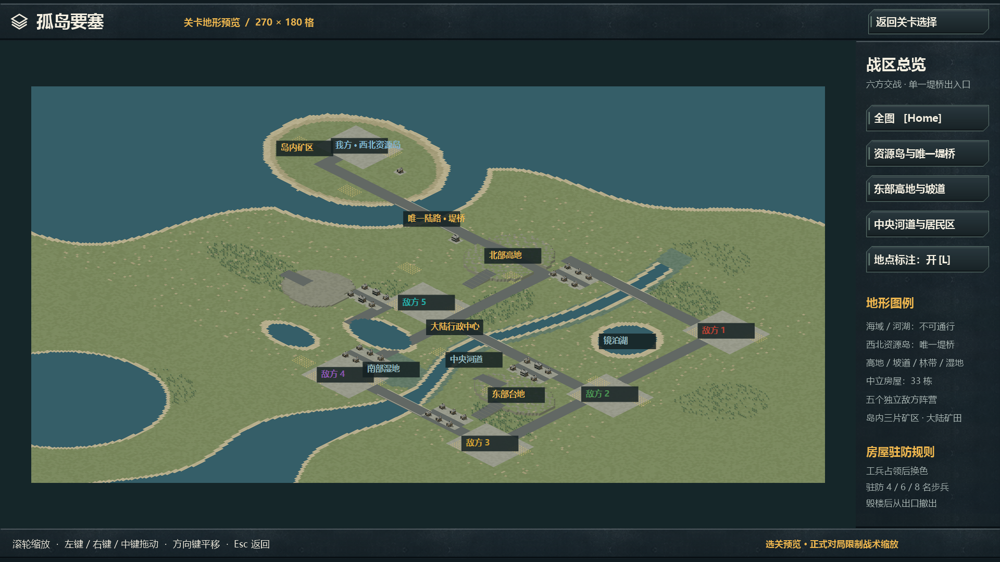

# 断线前沿 · 灰港登陆

现代战争单人即时战略游戏，Windows x64 原生桌面程序。最新发布 **v0.22.0 · 灰港与河湾战役更新**，详见[版本记录](CHANGELOG.md)。

本版重做第一、二关的地图、任务叙事和局内演出，缩减第三关外围地形，统一玩家与 AI 的车辆排产规则，并更新点选、集结和坦克开火表现。

从 [v0.22.0 发布页](https://github.com/Wenxin666-code/greyhaven-rts/releases/tag/v0.22.0) 下载 `Greyhaven-v0.22.0.exe`，可用 `SHA256SUMS.txt` 核对文件；也可在本机打开 `断线前沿.exe`。地图和正式素材嵌入程序，可离线运行，需要 Windows 自带的 .NET Framework 4.x。

- [战役主线与关卡规划](../../docs/design/战役主线与关卡规划.md) · [第四关任务设计](../../docs/design/第四关-雾脊中继站.md) · [敌军守备与出击记录](../../docs/design/第三关AI守备与出击模拟报告.md)
- [兵种解锁与驻防](../../docs/design/兵种解锁与步兵驻防-20261110.md) · [连续部署动作预览](../../docs/infantry-motion-20261110/部署与收起-修订.mp4) · [步兵模型源文件](../../art/source/infantry-v12/README.md)
- [矿车返厂修复](../../docs/design/矿车返厂修复-20261109.md) · [性能与载员核对](../../docs/research/性能与载员核对-20261110.md) · [建筑间距与晋升](../../docs/research/建筑间距与单位晋升-20261110.md)

设计和测试目录保留各次修改时的历史记录，其中“本地未发布”描述的是记录生成时的状态；本次发布范围以版本记录为准。性能测量对应记录中的机器和场景，不代表所有设备和战局的固定表现。

## 关卡

主线暂定名「重连灰港」。先遣队稳住旧码头，打通河湾大桥，再夺取资源岛和外围工业带，为查明封锁原因、恢复地区交通建立支点。选关与战场使用同一份任务简报，通关短文串联下一关。前四关可玩，第五至第八关处于设计阶段。[战役主线与关卡规划](../../docs/design/战役主线与关卡规划.md)

- **01 断线之夜** 在 88×58 格的旧港滩头开场。白天的两辆回港空车停入码头装卸位，夜间扣留的另一辆货车留在闸前并占用道路。序章自动播放，先遣队在跳板旁集结后点击「接管先遣队」。十步教学从工程车展开、矿车交付和出厂推进到清除封锁守军。通关后，保障队接管旧码头，先遣队沿公路前往河湾镇。
- **02 河湾镇**采用 92×68 格的单桥布局。我方从西岸出发，互相敌对的北线驻防军和白石矿务警卫队分驻东岸两侧。桥宽 7 格，两岸各有可驻防的中立房屋，三方各有就近矿区。击败或迫降两方后获胜。[关卡全图](../../docs/河湾镇-单桥全图.png)
- **03 孤岛要塞**采用 270×180 格六方战场。玩家从西北资源岛出发，岛内有三片富矿，一条宽 6 格的堤桥通往大陆。五个互相敌对的 AI 分布在大陆，地形包括河湖、湿地、林带、高地、坡道及 33 栋中立建筑。
- 第二、三关敌方增加矿车、扩建精炼厂和生产设施，持续排产、根据已知敌军调整兵种，组织小队进攻并回防。初始资金、价格、工时与单位属性遵守玩家规则。详见 [第三关与 AI 说明](../../docs/design/孤岛要塞与智能敌军.md)。
- **04 雾脊中继站**：240×180 核心地格、铺满雷达矩形的山地战场，包含三条推进方向、湖泊溪流、坡道林带、14 栋中立房屋与六片有限矿区。我方从西南建立基地，工兵夺控北岭 3×3 中继站后累计恢复 360 游戏秒通信；失守暂停并保留进度，站毁即失败。敌方使用实际矿石收入生产护卫与工兵反夺；恢复首次达到 50% 时，仍在抵抗的敌方另获一次性 7500 经费，屏幕显示通报并保留记录。切断其生产可减轻压力，无需歼灭全部敌军。
- 第四关开局已标明中继站的情报坐标。点击金色方向标签或「定位中继站」查看目标，点击「返回基地」继续部署；引导随任务阶段变化。定位保留部队选择与当前命令，不揭开周边迷雾；雷达仍需建成并供电后启用。
- 中继站自带任务用电，不产钱、不生产、不解锁雷达、不供驻防或基地扩建，不能出售或收起。普通攻击保护任务站，Ctrl 强制开火仍可摧毁。新增独立模型、可染色面板、96 帧设备待机、破损与燃爆表现。
- 旧战役入口关闭，旧地图仍保留为内部回归场景。

[第三关正式开局](../../docs/孤岛要塞-正式开局.png) · [资源岛与唯一堤桥](../../docs/孤岛要塞-资源岛与堤桥.png) · [第二关正式开局](../../docs/河湾镇-单桥开局.png)

## 建设与经济

选中指挥部后按 D 可原地收起为基地车。暂停菜单的「点地迁移」默认关闭，开启后可选中指挥部并左键指定迁移地点。选中兵营或车辆工厂后左键空地可设置集结点，保持选中时再次左键会改点，右键取消选择。

建筑在侧栏生产，完成后选取并放置，落地播放展开动画。建筑与防御独立排产，实际地基显示红绿提示；可在已有建筑附近扩建，平坦道路允许建造，水域、陡坡、占用格等禁止建造。没有统一的门前额外禁建行，但应保持生产出口和卸矿口畅通。

建筑与单位随生产进度扣款，缺钱时等待。建筑图标右键暂停、再次右键取消；单位图标右键先减少同类等待订单，只剩当前单时暂停，再右键取消并退回实际已付费用。左键继续，Shift 单击批量 5 单。

玩家和 AI 都按阵营共用一条车辆队列，最多 30 单（含当前）。每多一座完工的车辆工厂，车辆工时乘 0.8。两座厂为基础工时的 80%，三座厂为 64%。每个订单生产一辆，扣一辆的费用。双击车辆工厂可设置优先出口，出口受阻时成品可从同阵营其他畅通的车辆工厂出厂。失去排产所在工厂时，只要仍有完工的同类厂，订单及已付进度会转入该厂。

每座兵营各有 30 单，订单自动分配，可同时生产。指挥部的建筑与防御独立排产。总览可切换车辆队列和各座兵营，支持翻页、滚轮及逐单取消。缺电时生产速率按供电比例降至正常速度的 50%—80%。

基地车再次点击自身或按 D 展开。开启「点地迁移」后，选中基地点击地面可收起成车并移动。D 可原地收起。搬迁保留受损比例，建筑订单在没有展开基地时等待。K 进入付费维修模式，L 进入出售模式。

精炼厂价格 2000，完工且出口畅通后附带一辆矿车；车辆工厂可用 1400 补造。矿车采集连续矿格，满载 1000 后返厂卸货才获得军费。矿格逐格耗尽且不再生，教学关每格 1200、地形关卡每格 2400；矿车会重新寻找附近可达矿格，矿尽后的不足一车也会运回。多车按卸货流程排队，正常拥堵时保持返厂目标并绕行／等待；精炼厂被占领、摧毁或入口真正封死后才改选其他可达精炼厂。空车卸货后先驶离卸矿口再寻矿，矿区耗尽也不会留在入口堵住后车。

工兵进入建筑占领／修复后消耗；工兵进入步兵战车后，车辆切换为维修模式并停用攻击，可点名维修和卸载工兵。中立房屋仍遵循先占领、后驻防的顺序。

雷达建成且正常供电后启用小地图，不附带扫描能力。另可建设间谍卫星：1500 军费、耗电 100，需雷达与车辆工厂；正常供电时揭示全图，失效后恢复本方探索记录。

敌方同时失去基地／工程车、兵营／车辆工厂，以及战斗部队／工兵（包括驻军和载员），持续 3 秒后投降，残余建筑与辅助车辆自毁。基地展开中、基地收起中、设施施工中、缺钱、断电或出口堵塞都不会单独触发投降。存活工厂可补造工程车，存活兵营仍可补兵；玩家不会自动投降。

## 操作

关卡和教学默认采用 1×。按 Esc 可切换 1×、2×、3× 和 4×，模拟速率分别为每现实秒 2、4、6 和 8 游戏秒。生产、采矿、行进与战斗共同加速，镜头手感独立，倒计时按当前档位显示。敌方提前扩产和组队，并对长期未受进攻的阵营安排袭扰。参考时间与前后推演见 [对局节奏说明](../../docs/research/对局时间与AI节奏-20261108.html)。

- 默认无边框全屏，Alt+Enter 切换窗口；滚轮缩放、中键拖动、方向键及屏幕边缘滚屏。正式战斗缩放范围 1.05～2.4，默认 1.55，全图预览仅用于选关。
- 左键选择、框选及下达移动／攻击命令，Shift 增减选择，右键单击取消选择或待确认操作，按住拖动则快速滚屏并保留选择与原命令。再次点击已选单位通常保持选择；基地车等可部署单位执行对应部署操作。
- 情境鼠标提示可移动、不可达、攻击、采矿、卸货、部署、维修与出售等状态；点击不可达地块保留原选择和路线。
- Q/W/E/R 切换建筑、防御、步兵和车辆分类；Q/W 可取出对应已就绪建筑。D 展开／收起／卸载，K 维修，L 出售。
- Ctrl+Shift+左键攻击移动；Ctrl+左键强制开火，Alt+左键强制移动；Ctrl+Alt 地点警戒或护卫。S 停止，G 警戒，X 散开，F 镜头跟随。按住 Z 点击路径点、松开执行，或点指令栏路径按钮持续规划；点回已有路径点形成巡逻，可选择点后 Delete 删除。
- Ctrl+0～9 建立编组，0～9 召回，Shift 加选、Alt 或连按定位；T 选择画面内同类，快速再按扩展至全图；P 选择战斗单位，N 下一个、M 上一个，Y 按等级筛选。
- H 定位基地，空格定位事件；Ctrl+F1～F4 保存镜头，F1～F4 召回；数字键盘 5 定位选择；B 放标记、Enter 注记、Delete 删除；Tab 阵营信息，C 庆祝，Shift+S 截图。Esc 打开选项，可修改全部默认绑定。切出游戏自动暂停。

普通移动优先完成路线，坦克可进行机会射击；攻击移动会搜索、接敌并在射程位置停下作战，之后继续路线。警戒迎敌后返回，护卫跟随目标。混编配速允许落后者追赶，持续受阻者不拖停整队；后排攻击者会寻找射击位置。

底部为可收起的小指令栏，左下大单位详情卡与全局装甲升级已移除；车辆工厂直接开放装甲部队。雷达左键有选择时下令、无选择时定位，右键始终定位且保留选择。生产总览可从选项打开，「操作说明」「辅助范围」按钮已删除。来源、85 条默认键位和范围差异见 [键鼠与界面逐项核对](../../docs/research/键鼠与界面逐项核对-20261108.html)。

## 美术与模型

单位、建筑采用统一材质与光照，以装备和轮廓区分类型；实际战场尺寸与地基占格协调。主菜单「模型预览」可查看单位和建筑、自定义势力颜色，单位支持方向切换，矿车可切换空满载。建筑包含军用设施、驻兵碉堡、任务中继站及 3 类中立房屋，可切换待机、搭建和摧毁，支持播放／暂停、供电切换及自定义 RGB 涂装；士兵可查看关节行走、连续部署／收起及瞄准射击。涂装与本体独立，支持任意 RGB。

战场包含分构件施工、受损燃爆、开火、命中、受损烟火、维修火花、采矿和行车扬尘，以及士兵与建筑阴影。选择角标和血条采用像素边缘，并与实际模型位置对应。

[单位模型](../../docs/全单位模型.png) · [建筑总览](../../docs/十一类建筑施工骨架-v10.png) · [独立弹片与燃爆](../../docs/弹片与爆炸实机-v11.mp4) · [搭建与受损](../../docs/结构搭建与受损燃爆-v10.mp4) · [待机与步态](../../docs/待机展开与步态-v09.mp4) · [战场动画](../../docs/建造开火损毁-v08.mp4) · [历史动画演示](../../docs/建造开火损毁-v06.mp4) · [第一版及历史素材归档](../../art/archive/unit-art-history-20261106/README.md)。旧验收动画继续保留，不作为正式运行素材加载。

## 项目与验证

- `src`：C# 游戏规则、原生界面和绘制；`maps`：地图数据；`tests`：规则、交互和性能检查。
- `art/source`：可编辑模型与图集；当前使用 `units-v04`、`tank-prototype`、`buildings-v09`、`buildings-v10`、`blast-v11`、`unit-motion-v09`、`relay-v01`、`infantry-v12` 等素材；`buildings-v05`、`animation-v06` 为保留的旧建筑与旧动画。`art/review` 为验收资料，历史模型保留。
- `docs/design`：设计记录；`docs/research`：机制调研与来源说明。研究材料中的外部项目名称用于来源归属，版本说明描述本项目实际变化。
- `art/source/**/frames` 为可重新导出的中间帧，仅本地保留；模型源文件、材质和正式资源包随源码同步。
- 修改前的临时快照保留在本机 `art/archive/*-before-*`，不加入仓库；正式历史美术归档仍同步保存。

在 Windows x64、PowerShell 7 下执行 `./scripts/build.ps1` 构建。矿车返厂专项执行 `./scripts/build.ps1 -MinerVerify`；基地守备专项执行 `./scripts/build.ps1 -TerritoryVerify`；第三关模拟执行 `./scripts/simulate-third-mission.ps1 -Seconds 1800`；防御专项执行 `./scripts/build.ps1 -DefenseVerify`，射程截图执行 `-DefensePreview`；矿车、海域边界与雷达专项执行 `./scripts/build.ps1 -HaulVerify`，导出地图验收图执行 `-HaulPreview`；对局节奏专项执行 `./scripts/build.ps1 -TempoVerify`，截图及运行测量执行 `-TempoPreview`；键鼠与界面专项执行 `./scripts/build.ps1 -ControlsVerify`，同时导出界面截图执行 `-ControlsPreview`；完整游戏回归执行 `./scripts/build.ps1 -Test -RiverPreview -MapPreview`；第三关与智能敌军专项执行 `./scripts/build.ps1 -AiVerify`，地图截图与数据导出执行 `-IslandPreview`；爆炸弹片验收执行 `./scripts/build.ps1 -BlastPreview`，不录视频的专项检查执行 `-BlastVerify`；建筑施工与燃爆验收执行 `./scripts/build.ps1 -StructurePreview`；待机与步态验收执行 `./scripts/build.ps1 -MotionPreview`（录像需要 ffmpeg）；地图滚动与缓存专项执行 `./scripts/build.ps1 -ScrollPreview`；建造操作专项执行 `./scripts/build.ps1 -ConstructionPreview`。导出美术使用项目中的 Three.js 与其许可证，玩游戏不需要安装美术工具。

v0.22.0 的构建、验证范围和程序校验值见[发布核对记录](../../docs/releases/v0.22.0.json)。历史验证记录按原版本保留。
